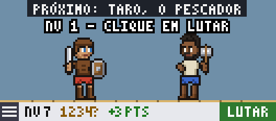
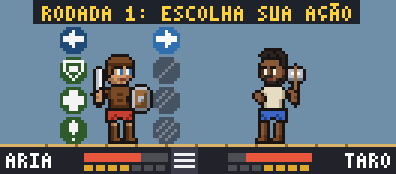
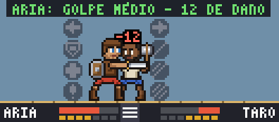
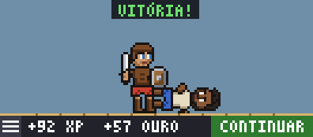
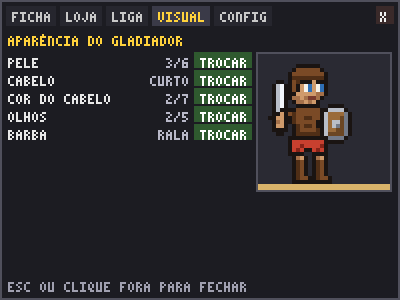

# TaskBarFGladiator

Jogo **original** de gladiador por turnos que fica **apoiado em cima da barra de tarefas do Windows**,
100 % offline, escrito em **Rust**, com foco em segurança, baixo consumo de memória e CPU, e estabilidade
para ficar aberto o dia inteiro.

> **Status:** em desenvolvimento. Concluídos: Fase 0 (repositório, CI, licenças) e o núcleo do jogo
> (crate `game`: combate, IA, progressão, save) com o simulador de balanceamento e o baseline congelado.
> Integração com o Windows implementada (crate `platform` e executável), com compilação e teste de
> fumaça no CI. **Ainda não validada manualmente em um Windows real**: veja como testar abaixo.

## Como compilar e testar (Windows)

Requisitos: [Rust](https://rustup.rs) e as Build Tools do Visual Studio (componente
"Desenvolvimento para desktop com C++").

```
git clone https://github.com/PedroRomanelo/TaskBarFGladiator
cd TaskBarFGladiator
cargo run --release
```

- Palco (acima da barra): clique esquerdo nos botões; passe o mouse sobre um botão de ação para ver o
  que ele faz; clique direito abre o painel; segure e arraste para mover.
- Ícone da bandeja: mostrar/ocultar, pausar, painel, reposicionar, sair.
- Save e configuração: `%APPDATA%\TaskBarFGladiator\`. Log: `%LOCALAPPDATA%\TaskBarFGladiator\logs\`.
- Lista do que testar: [`docs/09-verificacao-e-testes.md`](docs/09-verificacao-e-testes.md), seção 3.
>
> O nome "TaskBarFGladiator" é provisório. O nome definitivo do jogo ainda não foi escolhido
> (pendência P1 em [`docs/10-cronograma-e-decisoes.md`](docs/10-cronograma-e-decisoes.md)).

## O que é

- Um palco de pixel art sem fundo, apoiado no topo da barra de tarefas, onde acontecem lutas de
  gladiadores em uma arena de uma dimensão (avançar, recuar, golpes leves/médios/pesados, defesa, fôlego).
  Os lutadores têm cerca de duas vezes a altura da barra; o que está atrás do palco continua visível e
  clicável.
- Uma legenda no topo do palco diz sempre em que etapa você está e o que fazer: preparar, sua vez,
  rodada em andamento (quem agiu, dano, erro) e resultado.
- Lutador em camadas: a aparência do seu gladiador é personalizável (pele, cabelo, cor do cabelo, olhos,
  barba) e o equipamento é fixo, igual para todos (armas, escudos e as peças da armadura: elmo, peitoral
  e grevas).
- Progressão de personagem (atributos, nível, equipamentos, loja, ligas de torneio).
- Modo **manual** (você escolhe cada ação com o mouse) e modo **automático** (a IA luta por você com a
  estratégia que você escolheu, enquanto você trabalha).
- Um painel expandido (janela acima do palco) para ficha, loja, liga, aparência e configurações.

### Pré-visualização (renderização atual, gerada por `cargo run -p render --example preview`)

As quatro etapas do palco (escala ×3, a de uma barra de tarefas de 48 px):

| Preparar (tema claro) | Sua vez |
|---|---|
|  |  |
| **Rodada em andamento** | **Resultado** |
|  |  |

Painel expandido (aba Visual):



Folhas de sprites: [aparências](docs/img/folha-aparencia.png) e
[equipamentos](docs/img/folha-equipamento.png) em cada pose.

### Como criar ou alterar a arte

A arte fica em `crates/assets/src/parts.rs`, como grades de texto (uma letra por pixel, legenda em
`Ink::from_char`). O lutador é montado com peças: corpo por pose, depois cabelo, barba, elmo, peitoral,
arma e escudo. Para adicionar um corte de cabelo, uma barba ou uma arma, desenhe a grade, registre-a no
`enum` correspondente de `crates/assets/src/lib.rs` e rode `cargo run -p render --example preview` para
ver o resultado em todas as poses. Os testes de `assets` conferem que nenhuma peça sai da tela do lutador.

## O que não é

- Não é um port, remake, clone ou "recriação" de nenhum jogo existente. Não contém nome, personagens, arte,
  música, textos nem código de terceiros. As mecânicas são de gênero (RPG de gladiador por turnos) e todo o
  conteúdo é próprio ou de licença livre com crédito registrado.

## Metas técnicas

| Métrica | Meta |
|---|---|
| Memória (Private Bytes) | < 15 MB em uso normal |
| CPU parado | 0,0 % |
| CPU em combate animado | < 1 % de um núcleo |
| Executável | 1 arquivo, < 3 MB, portátil |
| Rede | nenhuma |
| Privilégios | usuário comum (nunca pede administrador) |

Plataformas alvo: Windows 10 22H2 e Windows 11 (23H2, 24H2 e posteriores).

## Documentação

Toda a documentação de planejamento está em [`docs/`](docs/README.md):

| Documento | Conteúdo |
|---|---|
| [00 — Visão geral](docs/00-visao-geral.md) | Objetivo, escopo, metas, aspectos legais |
| [01 — Arquitetura](docs/01-arquitetura.md) | Workspace, crates, renderização, loop, dependências |
| [02 — Fase 0: Preparação](docs/02-fase-0-preparacao.md) | Repositório, CI, licenças, nome |
| [03 — Fase 1: Plataforma](docs/03-fase-1-plataforma.md) | Janela na barra de tarefas e todos os casos de borda |
| [04 — Fase 2: Jogo](docs/04-fase-2-jogo.md) | Lógica, save, renderização, interface, balanceamento |
| [05 — Fase 3: Distribuição](docs/05-fase-3-distribuicao.md) | Polimento, soak test, release assinada |
| [06 — Casos de borda](docs/06-casos-de-borda.md) | Catálogo consolidado |
| [07 — Segurança](docs/07-seguranca.md) | Modelo de ameaças e medidas |
| [08 — Memória e desempenho](docs/08-memoria-e-desempenho.md) | Orçamentos, riscos e medição |
| [09 — Verificação e testes](docs/09-verificacao-e-testes.md) | CI, matriz manual, métricas |
| [10 — Cronograma e decisões](docs/10-cronograma-e-decisoes.md) | Prazos, decisões tomadas e pendentes |
| [11 — Design do jogo](docs/11-design-do-jogo.md) | GDD inicial: atributos, ações, fórmulas, IA |
| [12 — Balanceamento de referência](docs/12-balanceamento-de-referencia.md) | Metas, congelamento das regras, processo de alteração |
| [14 — Formato do conteúdo](docs/14-formato-do-conteudo.md) | Arquivos JSON de regras, itens e ligas |
| [15 — Plano: fluxo de jogo](docs/15-plano-fluxo-de-jogo.md) | Título, criação do personagem, atributos, intervalo entre lutas e economia (a executar) |
| [16 — Catálogo de itens](docs/16-catalogo-de-itens.md) | Os 88 itens com nível, atributos e preço; como pedir a arte de cada um |

## Licença

Código sob `MIT OR Apache-2.0` ([`LICENSE-MIT`](LICENSE-MIT), [`LICENSE-APACHE`](LICENSE-APACHE)).
Arte própria sob `CC-BY-4.0` ([`assets-src/LICENSE`](assets-src/LICENSE)).
